# AI와 하루, 움직여야 시간이 흐르는 FPS

**Overwatch의 영웅 전투에 SUPERHOT의 시간 감각을 더하면 어떨까.**

Codex와 MCP 도구를 연결해 Unreal Engine 5.8.3에서 만들어 본 싱글 플레이 FPS, **CHRONO // BREACH**의 제작 기록입니다.

[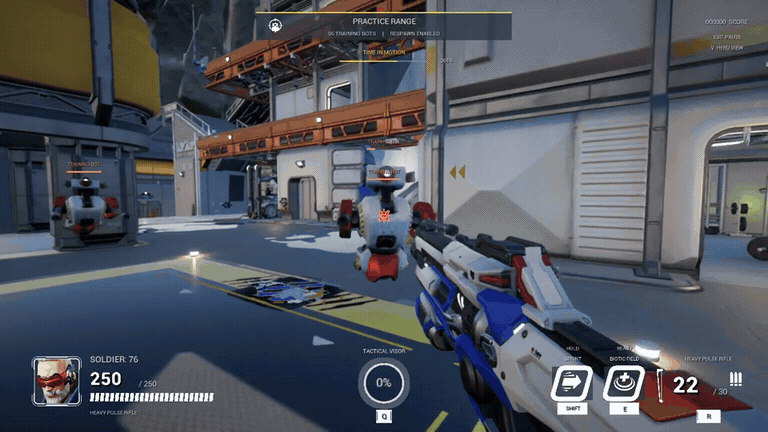](Media/highlights.mp4)

[▶ 하이라이트 영상 · 10초](Media/highlights.mp4) · [▶ 플레이 영상 · 약 14초](Media/playthrough.mp4)

## 작은 아이디어에서 시작했습니다

솔저: 76으로 훈련장을 돌아다니되, 가만히 서 있으면 적과 탄환이 느려지고 움직이면 시간이 다시 흐르는 게임을 만들고 싶었습니다. 익숙한 캐릭터와 공간 안에 다른 전투 규칙을 넣어 보는 실험이었습니다.

하루 안에 플레이 가능한 프로토타입을 만드는 것을 목표로, AI에게 기획을 설명하고 구현 결과를 실행해 보며 다음 작업을 정했습니다. Codex를 중심으로 Blender MCP와 언리얼 내장 MCP를 연결했고, 전투·스킬·UI·에셋 변환·검증을 하나의 흐름으로 이어 갔습니다.

> **제작 기간에 관하여**
>
> 첫날에는 이동에 따른 시간 변화와 전투·능력·아레나를 구현했습니다. 이 글의 영상은 이후 솔저 외형, 원본 훈련장·봇·HUD·힐팩을 추가한 확장 버전입니다. 초기 구현 기록은 2026년 10월 20일, 주요 에셋 통합은 10월 21–23일이며, 아래 에디터 화면은 소개를 위해 다시 촬영했습니다.

## 멈추면 생각하고, 움직이면 전투합니다

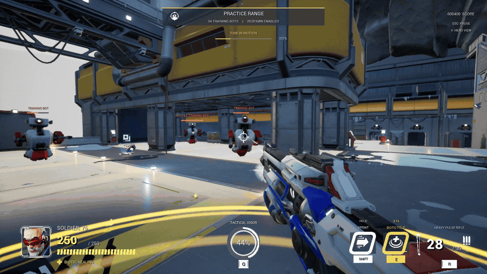

캐릭터의 실제 이동 속도로 세계의 시간 배율을 바꿉니다. 멈추면 적과 탄환은 약 2.5% 속도로 느려지고, 움직일수록 정상 속도에 가까워집니다. 조준과 장전, 능력 조작은 계속 반응하도록 시간을 따로 처리했습니다.

화면 상단의 `TIME IN MOTION`과 `TIME HELD`를 보면 변화가 드러납니다. 마우스를 돌리는 것만으로 시간이 빨라지지는 않습니다.

## 익숙한 영웅을 다른 규칙으로

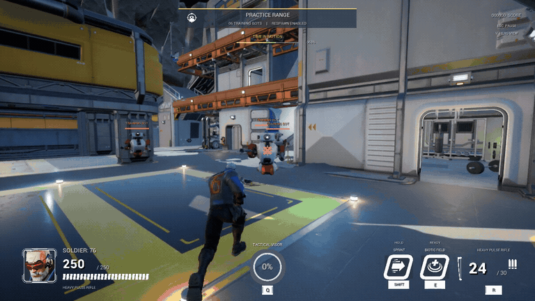

소총 사격과 장전, 질주, 생체장, 전술 조준경을 연결했습니다. 1인칭 팔과 외부 시점을 전환할 수 있고, 훈련봇을 처치하면 다시 등장해 전투를 이어 갈 수 있습니다.

| 소총 전투와 훈련봇 | 생체장과 회복 표시 |
| --- | --- |
| 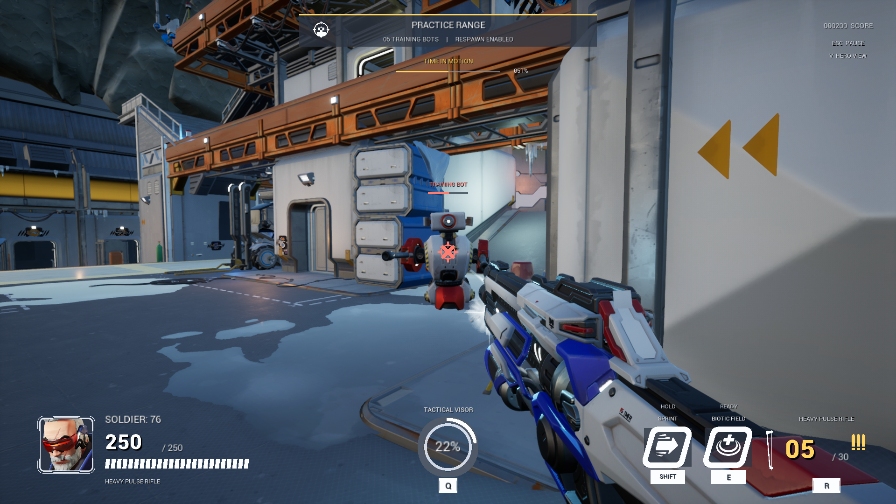 | 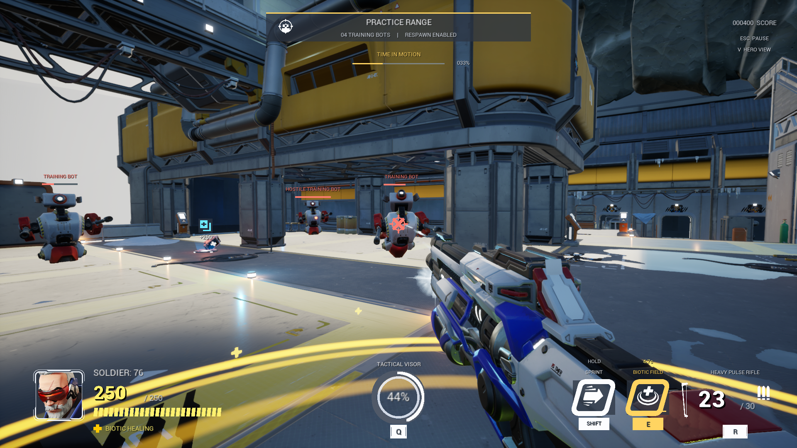 |

| 캐릭터 외부 시점 | 훈련장 전투 하이라이트 |
| --- | --- |
| 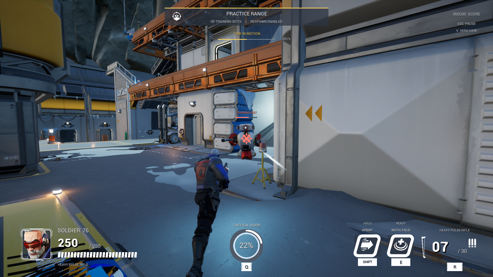 | 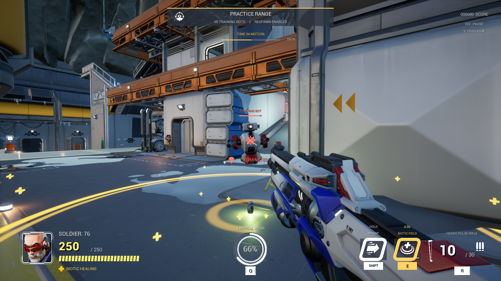 |

## 힐팩도 장식에서 게임 동작으로

맵에 보이는 의료 가방에 가까이 가면 부족한 생명력이 회복되고, 힐팩이 사라진 자리에 재생성 시간이 표시됩니다. 원본 모델과 의료 UI를 가져오는 것에서 끝내지 않고, 획득·회복·15초 재생성까지 연결했습니다.

| 획득 전 | 회복 후 |
| --- | --- |
| 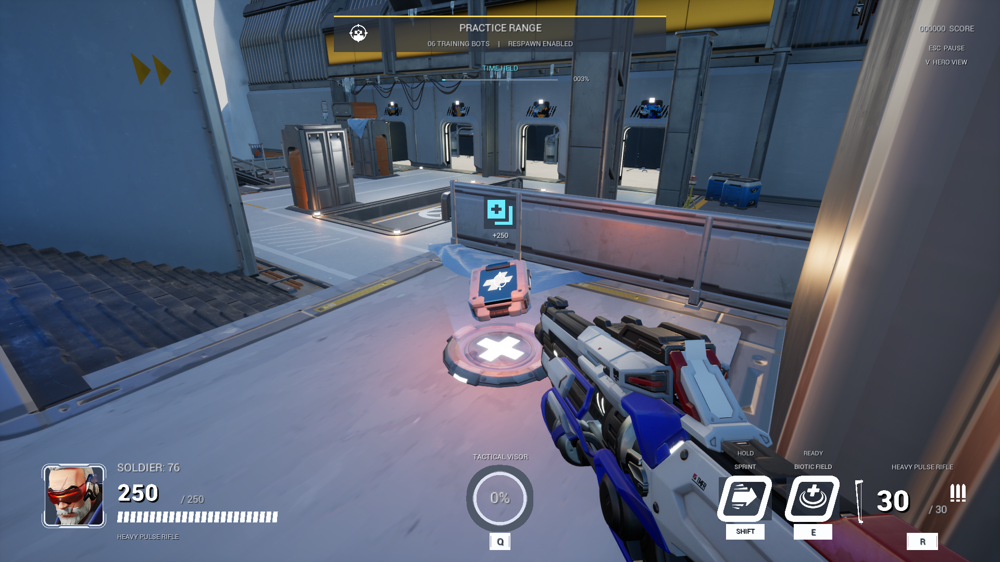 | 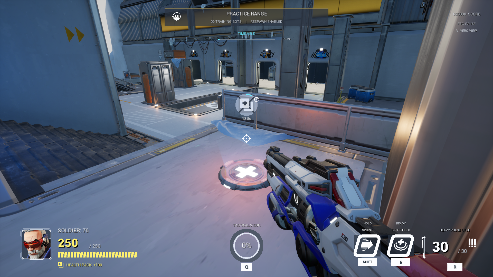 |

## 언리얼 에디터 안에서도 확인했습니다

[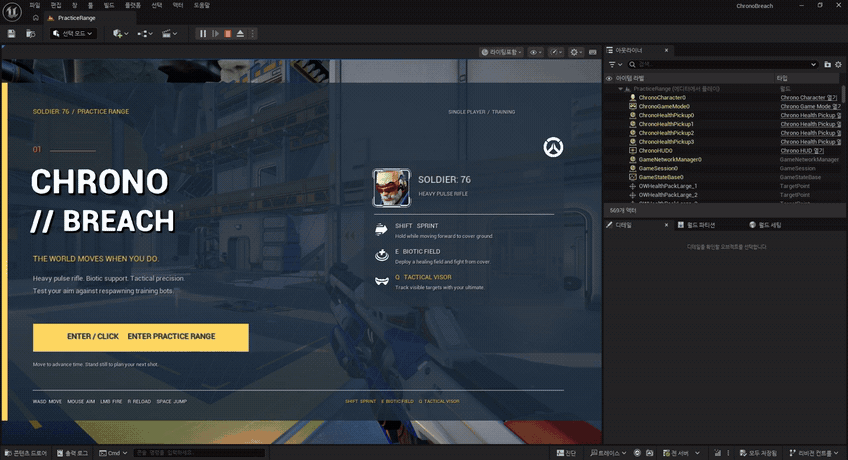](Media/editor-preview.mp4)

[▶ 에디터 실행 영상 MP4 · 15초](Media/editor-preview.mp4)

에디터의 Play In Editor로 훈련장을 실행하고 캐릭터·HUD·회복 동작을 확인한 실제 화면입니다. 시작 메뉴와 생체장, 캐릭터 외부 시점 구간을 발췌해 연결했습니다. 오른쪽 아웃라이너와 상단 실행 도구를 함께 남겨, 패키지 플레이 영상과 개발 환경을 구분했습니다. 2026년 10월 25일, 소개를 위해 현재 프로젝트를 다시 열어 촬영한 기록입니다.

| 에디터에서 시작 화면 확인 | 에디터에서 게임 실행 |
| --- | --- |
| 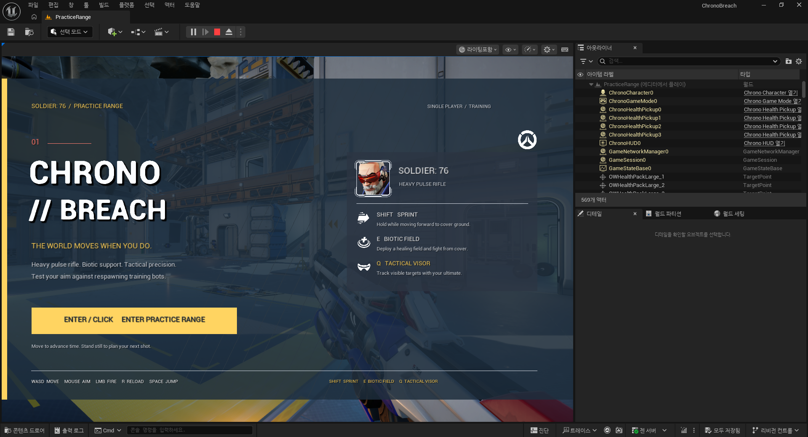 | 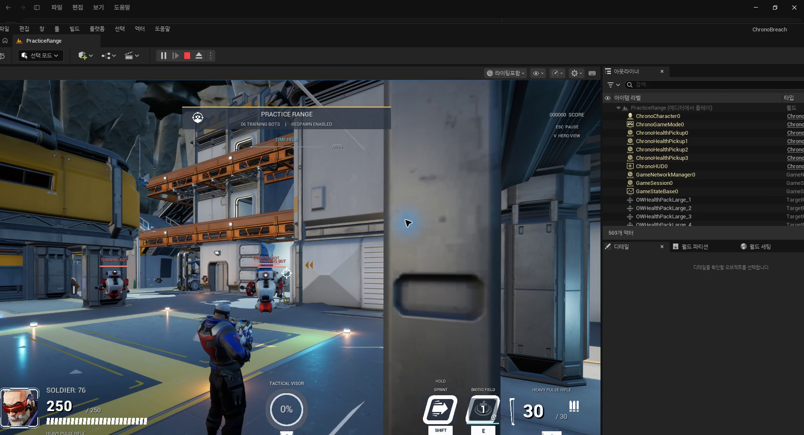 |
